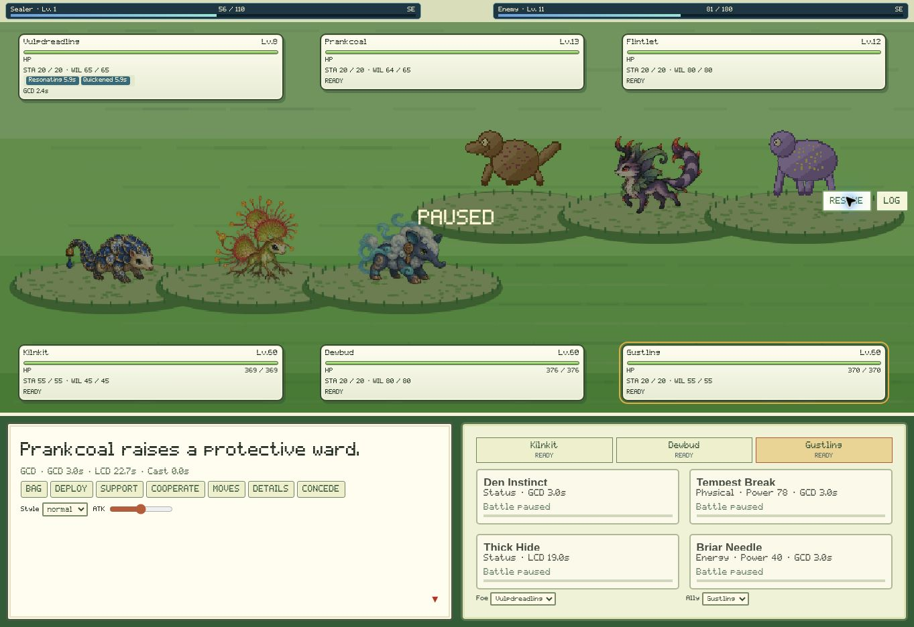

# Spirimon
An original, local-first browser RPG about people who seal Spirimon into tattoo bonds.

## Play
- **Hosted:** https://nathan-culver.github.io/Spirimon/ (after publication).
- **Local, no installation:** open Spirimon.html in a normal desktop browser. The in-app preview may block local file URLs.
- **Local companion:** install Node.js 20 or newer, then double-click Start-Spirimon.cmd, or run npm start and open http://127.0.0.1:4317.
- No npm dependencies, API keys, subscriptions, or paid generation services are required.

Saves and the species library live in this browser's IndexedDB. Hosted, local-server and standalone-file versions have separate storage origins. Use Settings → Export/Import to transfer a world. Export before clearing browser storage. Browser storage is not a substitute for a backup.

## Controls
WASD / arrows: move. E / Enter: interact. B: bag.
1: explore. 2: tattoos. 3: atlas. 4: journal.
Hold Shift to run. Touch/click movement controls are on the map. Tile movement and camera scrolling are smoothly interpolated; the world fills the window without letterboxing.

On phones, Spirimon automatically uses a landscape emulator layout with translucent D-pad, A/B, Menu and Bag buttons. Hold a direction to keep walking. A interacts; holding B runs. The BAG button opens supplies. MENU opens Spirimon, Map, Journal, Sealer, Options and Save. Rotate the phone sideways; fullscreen and orientation locking are offered where the browser supports them. Settings can force emulator or desktop layout. Battle and collection menus remain directly touchable. Mobile saves stay on the phone; export/import moves saves between devices. AI generation targets the Windows companion, not phone hardware.

## The first journey
Begin with no Spirimon. Your first encounter is random: earn its trust with interaction or offerings, then complete the sealing challenge. A completed fresh local-AI lineage is used when available; otherwise the original shared roster provides the encounter. Keeper Iona restores Spirimon; Tavi sells supplies; Rowan offers rank-scaled battles and reserve Spirimon trades; Scholar Elin rewards discoveries and exploration. Roaming Spirimon can be approached peacefully, offered food, or challenged. Hidden encounters occur in tall grass.

## Art direction and animations
A bright handheld-era presentation with original feudal Japanese/Chinese-inspired pixel villages: swept tiled roofs, timber halls, lanterns, shrine gates, bamboo, cherry trees and robed sealers. Exploration fills every screen shape. The overworld uses textured forest canopies, tall-grass patches, terraced cliffs, shoreline banks, bright village tiles and smooth grid-aligned movement. Battles use compact HP, Stanima, Willpower and XP HUDs, a bottom dialogue window and Fight / Bag / Spirimon / Run menus. Physical lunges, elemental streams, ice shards, leaf bursts, healing and wards animate across the battle stage. Reduced-motion preferences are respected. An original offline 5×7 pixel font ships with the game.

The shared roster contains 150 lineages: 50 original artwork-backed lineages and 100 awaiting finished artwork. Those unfinished lineages display the supplied question-mark mystery creature, including its walking animation. Each has three distinct forms. New discoveries can also create additional lineages from the expanded anatomical catalogs. Artwork has transparent backgrounds and bounded 256×256 form cells. Local AI lineages become encounterable only when all three sprites and their validated information are complete.

## Buildings
Walk north into a doorway or interact directly below it. Sealer Halls, inns and homes have interiors, residents and a south exit. Hall keepers restore HP, Stanima and Willpower; attunement is available at safe places.

## Implemented systems
- Seeded, expanding world with five biomes, persistent regions, towns, terrain collision, trails and fixed regional danger.
- 12 ordered, distinct base/modifier types, complete three-form lineages, one guaranteed appropriate Domain and repeated independent 1% additional-domain rolls.
- Mutually exclusive wild-form rolls: starting 94%, intermediate 5%, final 1%.
- Habitat-weighted species selection, 90% familiar / 10% new for already discovered ordered type pairs when rolling new encounters. Already placed Spirimon retain their identities.
- Shared local species library, with per-world discovery history.
- Six attuned tattoo Spirimon; reserves remain sealed. Change attunement in towns.
- Combined attack/defense power, unnumbered commitment slider, physical/spiritual resistance, physical/spiritual move traits, intuitive core matchups, statuses, passive abilities, speed modifiers and independent Agile/Normal/Strong styles.
- Real-time single/double battles with per-Move cooldowns, casts, shared recovery, independent enemy AI, Pause and optional ally automation.
- Shared Stanima for Physical moves and Willpower for Energy/Spiritual/Status moves, soul draught recovery, and Struggle with recoil when no move can be funded.
- Battle sealing influenced by health, status, catalyst quality and form; cooperative sealing through patience/offerings and an accessible timing challenge.
- Levels, individual potential, natures, training investment, bonds, permanent level/bond transformations, and cosmetic switching among unlocked forms.
- Guild rank, field techniques requiring suitable Spirimon, support wards, simple friendships, NPC trade, optional notices and a field journal.
- Recovery cost after defeat; supplies remain recoverable at the defeat location.
- Autosave, battle resume, export/import and previous-world recovery.

## Real-time combat, Stanima and Willpower
Tap a ready Move to begin its cast. Both sides act on one elapsed-time clock; enemies never wait for player input. Each Spirimon has per-Move cooldowns and shared recovery, so cycling four powerful Moves or switching cannot bypass recovery. In doubles, select either ally or turn on Auto for that ally. Bag actions and switching use the same timeline. Borrowed actions and round debt are removed from live combat.

Pause stops combat explicitly. Hidden/background tabs and required replacement selection also stop it; elapsed time away is not replayed on return. Menus and the battle log otherwise leave combat running.

Moves scale at levels 1, 16, 36, 60, 85 and 100. Quick, resource-efficient attacks, slow burst attacks, control, recovery and conditional combinations have separate roles. Cooldowns account for expected hits, accuracy, secondary effects and spread targeting. See [real-time rules](docs/real-time-combat.md) and the [complete Move audit](docs/move-balance-audit.csv).

Each equipped Physical Move contributes to maximum Stanima; Energy/Status Moves contribute to Willpower. A funded execution costs one point, or two against Pressure; shortages can convert the other pool at two-for-one. Items do not replace the four equipped Moves. Struggle remains available only when no equipped Move can be funded. Resource maximums, collections, learned Moves and current encounter progress survive migration. New timed afflictions include sleep, freezing, confusion, burns, poison, toxic poison, paralysis and frostbite; HUD badges display their remaining seconds.

## Optional free local AI
The game is immediately playable with **authored roster artwork and procedurally generated creature designs**. Unfinished creature artwork uses the supplied mystery creature; basic geometric anatomy diagrams are never displayed as finished sprites.

For actual AI generation:
1. Install Ollama from its official site and download a text model suitable for your RAM. No model is bundled, and Spirimon does not download models automatically.
2. Run a compatible local Stable Diffusion WebUI with its API enabled (typically --api) and a locally installed image model.
3. Run Start-Spirimon.cmd.
4. Open Settings → Check companion, choose an installed text model, and enable local AI.
5. Queue a lineage or explore new regions.

Default endpoints:
- Text: http://127.0.0.1:11434
- Image: http://127.0.0.1:7860
- Companion: http://127.0.0.1:4317

Text generates a schema-checked three-form design and can propose bounded, anatomy-compatible move mechanics. Code preserves type rolls and species statistics. External image generation runs sequentially and requires a local vision model for semantic checks. Later forms use the first sprite as an image-to-image reference. Without image verification, procedural anatomy diagrams remain internal design data and the supplied mystery creature remains visible in the game. A lineage enters the species library after three complete validated forms. Discovered species are never silently replaced. See [Creature generation](docs/creature-generation.md) and the [full reference catalog](docs/creature-catalog.md).

Windows computers without a dedicated GPU may take a long time to generate images. Actual model quality, memory use, evolution consistency and generation latency still require hardware testing. Review the licenses of models you choose; freely downloadable does not automatically mean unrestricted redistribution.

Custom loopback endpoints can be set with SPIRIMON_OLLAMA and SPIRIMON_IMAGE. Additional trusted browser origins can be supplied in SPIRIMON_ORIGINS (comma-separated). The companion binds only to 127.0.0.1 and permits the player's GitHub Pages origin plus local play. No credentials are embedded. Browser local-network permissions may apply; if the hosted page cannot reach the companion, play through its local URL instead.

Official adapter references:
- https://docs.ollama.com/api/generate
- https://github.com/AUTOMATIC1111/stable-diffusion-webui/wiki/API

Append ?playtest to the hosted URL for a separate browser playtest save and species library. Use ?playtest=your-test-name for an independently isolated test slot. It never reads or writes the regular game's IndexedDB database.

## Development
npm test
node build.mjs
npm start

engine.mjs: deterministic generation and combat rules.
sprites.mjs: original procedural pixel renderer.
app.mjs: gameplay, interface, browser storage, generation queue.
companion.mjs: static server and local-model adapters.
build.mjs: dependency-free Pages bundle and standalone HTML packager.
tests/: rule and HTTP tests.

Pushes to main run .github/workflows/deploy-pages.yml: build, run regression tests, stage the runtime files in _site, and publish them with actions/deploy-pages. Run `node build.mjs --out-dir _site` to reproduce the published artifact. The entry page loads one content-versioned classic JavaScript bundle; the four original world atlases load independently with bounded retries. The generated Spirimon.html download includes code, font, styles and world atlases for offline play. `npm start` builds these files before starting the companion server. Startup failures preserve the existing browser save; Retry loading requests fresh HTML without clearing storage.

## Scope of this release
This is the first playable alpha, not a completed FireRed-sized RPG. It has original assets and rules inspired by the agreed design. Authored dungeon adventures, tournament brackets, richer NPC event chains, additional transformation quests, full creature animation sets and production balance remain expansion work. The implemented combat rules, equipment, aspects and double-battle behavior are documented in [Combat systems](docs/combat-systems.md). The local model adapters are optional and need installed models; no actual AI model or generated AI artwork is bundled.

## Latest expansion
All50 lineages and150 distinct sprites are included. Detailed painted ground textures and irregular paths/shorelines match the town/Spirimon art. Six enterable building types include the forge, herbalist and archive; towns also have roofed stone wells, barrels, crates, guardian statues, timber fencing, stone walls and stalls. The lead Spirimon no longer follows on the map.

Wild encounters stay level1–5 in the starting region and6–8 in its eight immediate neighbors. After every seeded group of1–3 towns visited, newly formed farther areas gain1–3 levels. Caught Spirimon levels are preserved; old wild encounters are rebalanced.

The move library has eight techniques for each of13 main types and four for each rare domain. Individuals can practice alternative moves at safe places. Mobile move menus reserve a separate Back row. Cosmetic changes and permanent transformations use generic seal-ring/silhouette/particle animations.

Offerings are one cooperation attempt per individual. Choose a resource plan: lavish requires one trial, careful two, humble three. Materials and a seal catalyst are consumed at commitment. Trial order is randomized perindividual; riddles allow one answer, while singing and dance use15-second original wordless synthesized melodies. Exact input timestamps are scored at±45/90/150ms with60% required. Options offers eight-tap median lag calibration. Failed Spirimon remain available for battle and battle seals. Closing or reloading an active trial forfeits cooperation for that individual.

Music is synthesized from original note sequences, requiring a first click/tap for browser audio permission. The map uses calm instrumental music; battles use an upbeat instrumental arrangement. Music can be muted in Options. No copyrighted recordings or external audio services are used.

## Combat expansion

The battle engine now supports timed move effects, entry hazards, Baton Pass, team support, selectable targets, spread attacks and up to three manually controlled Spirimon per side. Opponents use a local scored decision tree and coordinate targets and switches. Twenty held items and eight unlockable aspects provide distinct individual builds. See [Combat systems](docs/combat-systems.md) for their rules and verification.

## Procedural Held Items

Held Items now generate from 37 archetypes across six categories, with five rarities and individually seeded relics. Each Spirimon has one slot; most items are universal, and verified grasping anatomy grants additional choices without stronger bonuses. Activate item abilities through Bag instead of a normal move. Consumables stay spent. See [Held Items](docs/held-items.md) for generation, effects, merchants, rewards and save compatibility.

## Spiritual Energy and GCD/LCD combat

Sealers now spend Energy to release non-lead Spirimon, use generated support, seal new creatures, and perform cooperative rituals. The designated lead is free even at zero Energy. Prepare six assigned techniques across the traveling party plus one distinct floating technique; learn the procedural catalog through instruction and discoveries. Communing at individually tracked shrines restores 50%, meditation 25%, and passive recovery takes two hours of active exploration.

Battles use a 3.5-second base GCD (1.5-second haste floor), independent LCDs, casting/animation locks and no action queue or allied automation. Creature Speed affects GCD/LCD timers; Move Speed is retired. Cooldowns survive battles, healing, recall, revival, preparation changes, and saved journeys.

Read [the complete Spiritual Energy rules](docs/spiritual-energy.md), [Move audit](docs/move-balance-audit.csv), [Energy economy audit](docs/spiritual-economy-audit.csv), and [example procedural support audit](docs/support-generation-audit.csv). Run `npm test`, `npm run audit:moves`, and `npm run audit:energy` to reproduce validation.

