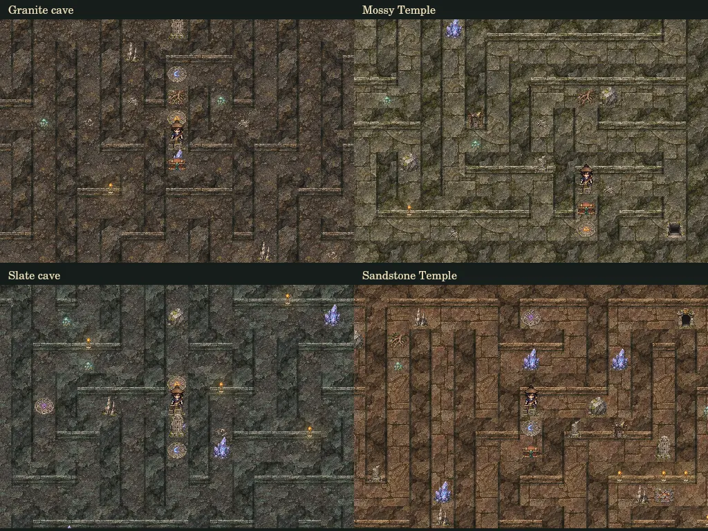

# Dungeon artwork

The cave and Clan Temple renderer uses the same detailed, muted pixel-art
direction as the settlement buildings and interior materials. World cells
remain 32 pixels; saved maps, collisions, mechanisms and puzzle placement do
not change.

- `assets/dungeon-materials-v1.webp`: 1024 × 1024, four columns and four rows.
  Columns: granite, mossy limestone, cool slate, umber sandstone. Rows: cave
  floor, rough bedrock, wall face, ancient Temple flagstones. Each 256-pixel
  material supplies sixteen 64-pixel phases to avoid a repeated tile outline.
- `assets/dungeon-props-v1.webp`: 1024 × 1536, four columns and six rows,
  transparent background. The 24 names and exact cell order are exported as
  `DUNGEON_PROP_NAMES` in `dungeon-atlas.mjs`.
- Boulders, roots and crystals identify Push, Cleave and Crush obstacles.
  Chests, counterweights and unstable floors have distinct interacted states.
  Three colored sigils match the glyph descriptions in the inscription clue.
- Sparse mushrooms, bones and rubble decorate unoccupied floor cells. Torch
  light, pillars and winches attach to wall faces. Decoration is deterministic
  and cannot replace a stair, puzzle object or mechanism. Props and creatures
  share a depth-sorted draw queue; ground sigils remain beneath their feet.
- The online release loads the two atlases through the existing image cache.
  The standalone build embeds their exact bytes for offline use.

## Art provenance

Created with built-in image generation. The generated material sheet was
mechanically sliced, its cell separators trimmed, and its cells packed into a
regular 256-pixel grid; the prop sheet was encoded as quality-90 WebP with its
alpha channel preserved losslessly. Original images are retained alongside
this task's generated outputs.

Prompt direction: **finely dithered overhead fantasy RPG pixel art, weathered
stone, moss, bronze and cedar; muted granite / sage limestone / slate /
sandstone materials; upper-left light; separate full sprites with transparent
padding; no labels, UI, modern elements or crude rectangular placeholders.**
Material prompts requested four families of seamless floors, bedrock, wall
faces and carved Temple flagstones. Prop prompts specified the 24 named cells
in the exported order, including paired chest, lever and hazard states.
